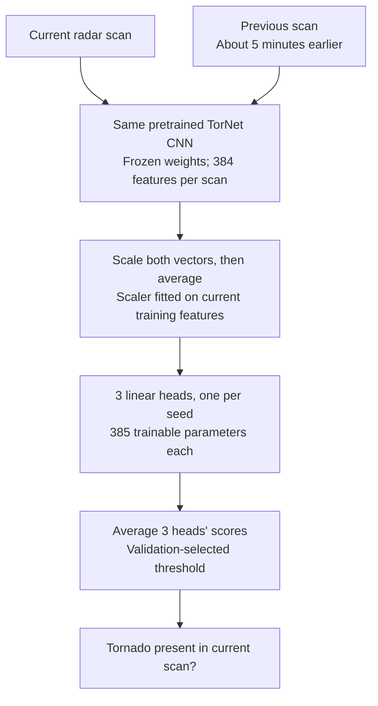

# TorNet transfer learning

**Does five minutes of radar history help detect a tornado in the current scan?**

This experiment freezes the pretrained TorNet radar CNN and compares four small
prediction heads across three seeds. It uses **6,414 radar clips from 2014–2015**,
split by storm groups to keep related observations together.

**The result:** two-scan averaging won validation and modestly improved test
ranking, but produced roughly twice as many false positives as the original CNN
at the chosen thresholds. The experiment does not establish an operational improvement.

**Start with [the single notebook](tornet_study.ipynb)** for the complete code,
saved tables and charts, verification, and tests. [RESULTS.md](RESULTS.md) has
the detailed findings; [SETUP.md](SETUP.md) explains how to run it.

## How it works

Each scan contains six radar variables at two elevation tilts. Only the small head
is trained. Averaging the features tests persistence and smoothing rather than
learning a storm trajectory.

## What the experiment found

Every row changes one factor from the current-scan linear baseline. AP is average
precision: it measures ranking across thresholds, and higher is better.

| Adaptation | Mean validation AP ± seed SD | Head parameters |
| --- | ---: | ---: |
| Current scan / linear | 0.658 ± 0.005 | 385 |
| **Two-scan mean / linear — selected** | **0.675 ± 0.001** | **385** |
| Double warning-negative loss weight | 0.656 ± 0.005 | 385 |
| Current scan / 64-unit MLP | 0.670 ± 0.007 | 24,705 |

The configuration and each model's threshold were chosen on validation, then
locked before testing. Test results cover **1,422 clips, 89 positives, and 10
storm groups**. These counts describe clips, not independent tornado events.

| Test model | AP | Precision | Recall | False positives |
| --- | ---: | ---: | ---: | ---: |
| Selected two-scan adaptation | 0.548 | 10.9% | 77.5% | 564 |
| Original pretrained CNN | 0.517 | 19.8% | 76.4% | 276 |
| Current-scan linear adaptation | 0.508 | 10.9% | 78.7% | 571 |

## Biggest lessons

- **Better ranking did not mean fewer false alarms.** The selected adaptation
  detected 69 positive clips versus 68 for the original CNN, with 288 additional
  false positives. Its AP gain was +0.031, with a descriptive paired storm-group
  95% bootstrap interval of **[-0.061, 0.155]**. A reliable improvement is not established.
- **A small temporal change was competitive.** Averaging two scans improved
  validation AP with the same head size. The much larger MLP was not selected
  under the declared rule. More capacity was not necessary for this result.
- **Extra hard-negative weight did not help here.** It slightly reduced mean
  validation AP and increased warning-negative false-positive rate at the recall
  target. The differences are small; they do not establish why it failed.
- **Audit identities and use the actual labels.** Legacy embedded warning IDs
  initially rejected 2,325 clips. The corrected v1.1 catalog, filenames, sites,
  and timestamps resolved grouping identity without changing labels or splits.
  Sampling categories are not substitutes for terminal-frame labels.
- **Accuracy hides failure when positives are rare.** Predicting no tornado gets
  93.7% test accuracy while missing every positive clip. Use AP, precision/recall,
  false-positive counts, and uncertainty across storm groups together.

This is retrospective **current tornado detection on selected radar crops**.
The study does not demonstrate advance forecasting or operational warning
performance. Only two years and 10 test storm groups limit generalization;
possible pretraining weather overlap remains. Scores are not calibrated probabilities.

## Run or inspect

Open [tornet_study.ipynb](tornet_study.ipynb) to read the saved outputs directly
on GitHub. To execute it, use Python 3.11, install `requirements.txt` in a virtual
environment, select that notebook kernel, and **Run All**. Full commands are in
[SETUP.md](SETUP.md).

Run All verifies the completed study and runs synthetic integrity tests. The
18.8 MB public checkpoint downloads once and must match its recorded SHA-256.
Raw-radar acquisition is opt-in; its two archives total **32.46 GB**.

| Kept in the repo | Purpose |
| --- | --- |
| `tornet_study.ipynb` | All first-party study code, findings, plots, and tests |
| `data/` | Aligned cached features, audited manifest, provenance, and release notices |
| `results/` | Measured runs, trained heads, locked decision, and saved predictions |
| `design/`, `planned_config.json`, [PROTOCOL.md](PROTOCOL.md) | Split evidence and scientific design |
| `upstream/`, `upstream_revision.txt` | Required authors' loader/Keras code and MIT license |

## Sources

Built on the [TorNet paper](https://arxiv.org/abs/2401.16437),
[MIT Lincoln Laboratory's code](https://github.com/mit-ll/tornet),
[public pretrained CNN](https://huggingface.co/tornet-ml/tornado_detector_baseline_v1),
and official v1.1 [catalog](https://zenodo.org/records/12636522),
[2014 data](https://zenodo.org/records/12637032), and
[2015 data](https://zenodo.org/records/12655151). Software attribution and licensing
are retained in [upstream/LICENSE](upstream/LICENSE); original dataset release
notices and licenses are retained in `data/archives/*_zenodo_metadata.json`.
